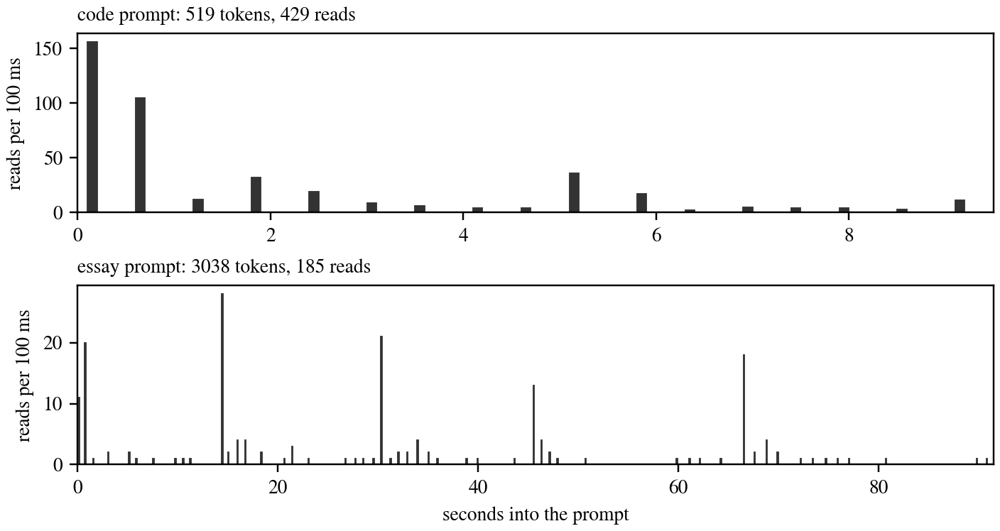

<picture>
  <source media="(prefers-color-scheme: dark)" srcset="assets/solfird-ai-on-dark.svg">
  
</picture>

# Black-Box Measurements of a Flash-Routed Mixture-of-Experts Language Model on a Mac

Solfird AI Technical Report 2026-01 · November 2026 · Julien Simon

[Report (PDF, 13 pages)](apple-fm-black-box.pdf) · DOI [10.5281/zenodo.24244064](https://doi.org/10.5281/zenodo.24244064) (version 1.0) · all versions: [10.5281/zenodo.24244063](https://doi.org/10.5281/zenodo.24244063)

## The result

Apple's on-device model Core Advanced holds 2.0 to 3.4 GiB of memory on a Mac, against 14 to 16 GiB for a 4-bit open
mixture-of-experts build. It pays for this with short bursts of reads from flash: 152 to 228 blocks in 15 to 24 ms at
the start of a prompt, then mostly 1 to 4 blocks at a time. For a model builder, this is where the cost of the design
lands: in storage traffic for tens of milliseconds, not in memory.

Apple says the model stores 20 billion parameters in flash, activates 1 to 4 billion at a time, and routes per prompt
instead of per token. Apple has published no technical report on it. This report measures the shipped model from
outside, on one M3 Max MacBook Pro, without opening any model file. The measurements support Apple's description on
every point they reach.



*Expert reads of 294,912 bytes per 100 ms during two prompts. Top: a code prompt, run first. Bottom: an essay, run
after eight other prompts. The time axes differ.*

## Main results

| Result | Value | Basis |
|---|---|---|
| Expert store | One 4.95 GB file, read only in blocks of exactly 294,912 bytes, all on one grid | Measured |
| Size of one block | Three 1536 x 256 matrices at 2 bits per weight | Derived, inferred |
| First burst of a prompt | 152 to 228 blocks at 2.5 to 3.3 GiB/s for 15 to 24 ms; mean load 3.0 MiB/s | Measured |
| Reselection | Bursts every 31 to 32 tokens on three prompts, irregular on a long one | Measured, derived |
| Memory | Apple's two processes hold 2.0 to 3.4 GiB, against 14 to 16 GiB for a 4-bit open mixture-of-experts build | Measured |
| Attention cache | 35,840 bytes per token, which excludes a uniform cache of 12 key-value heads | Derived, inferred |
| Tokenizer | Token counts match Gemma 3's tokenizer on 429 of 429 strings | Measured |
| Energy on 20 math problems | 35 to 36% of the lowest open build, without SSD and DRAM power (preliminary) | Measured |

Every statement in the report is labeled measured, derived or inferred. All results come from one machine.

## Reproduce the numbers and the figures

No model, no network access and no Mac are needed. You need Python 3.10 or later and [`uv`](https://docs.astral.sh/uv/).

```sh
uv run --with matplotlib==3.9.2 --with numpy python analysis/make_figures.py
(cd measurements && python3 scripts/check_numbers.py)
git diff --stat results/
```

The last command must print nothing: `results/derived_numbers.json` does not change. The figures in `figures/` are
rebuilt as PDF files and show as changed, because a PDF carries its build time.
[`measurements/README.md`](measurements/README.md) has the commands that take the measurements again on your own Mac.

## What is in this repository

| Path | Content |
|---|---|
| [`apple-fm-black-box.pdf`](apple-fm-black-box.pdf) | The report |
| [`measurements/`](measurements) | The full measurements: 263 files with the raw tables, the logs, the scripts that took them, and one record per finding. Start with [`findings/INDEX.md`](measurements/findings/INDEX.md) |
| [`measurements/scripts/check_numbers.py`](measurements/scripts/check_numbers.py) | Recomputes the main measured numbers from `measurements/data/` |
| [`analysis/make_figures.py`](analysis/make_figures.py) | Computes the two data figures and every derived number of the report from `measurements/data/` |
| [`analysis/burst_windows.py`](analysis/burst_windows.py) | Computes the first-burst windows from a raw `fs_usage` trace |
| [`results/`](results) | Outputs of the two analysis scripts: `derived_numbers.json` and `burst_windows.json` (the second one from the author's trace) |
| [`figures/`](figures) | The two data figures of the report |

`measurements/` is a copy, without change, of [`juliensimon/apple-fm-mac`](https://github.com/juliensimon/apple-fm-mac/tree/v1.0)
at tag v1.0, which the report cites. Those measurements were first published with an article, so the README and the
finding records in that folder refer to "the article". The report uses the same data.

## Where each result comes from

Section numbers are those of the report.

| Result | Section | Evidence |
|---|---|---|
| First bursts and mean load | 4.1 | [`ifp_reads.csv`](measurements/data/plots/ifp_reads.csv), [`ifp_phase_summary.csv`](measurements/data/plots/ifp_phase_summary.csv), [`burst_windows.json`](results/burst_windows.json), [`fig_reads.pdf`](figures/fig_reads.pdf), [`finding 02`](measurements/findings/02-expert-reads) |
| File size, block size, read grid, weights in memory | 4.2 | [`ifp_reads.csv`](measurements/data/plots/ifp_reads.csv), [`ifp_cadence_reads.csv`](measurements/data/plots/ifp_cadence_reads.csv), [`parameter_budget.csv`](measurements/data/plots/parameter_budget.csv), [`derived_numbers.json`](results/derived_numbers.json), [`finding 03`](measurements/findings/03-loaded-pages-and-bit-width) |
| Reselection period | 4.3 | [`ifp_cadence_reads.csv`](measurements/data/plots/ifp_cadence_reads.csv), [`finding 02`](measurements/findings/02-expert-reads) |
| Memory of the two processes and of the open builds | 4.4 | [`footprint_categories.csv`](measurements/data/plots/footprint_categories.csv), [`memory_protocol.json`](measurements/data/compare/memory_protocol.json), [`run_moe_footprint.log`](measurements/data/compare/run_moe_footprint.log), [`finding 04`](measurements/findings/04-memory) |
| Energy | 4.5 | [`energy_results.json`](measurements/data/compare/energy_results.json), [`energy_results_4bit.json`](measurements/data/compare/energy_results_4bit.json), [`finding 05`](measurements/findings/05-power-and-energy) |
| Accuracy on the same questions | 4.6 | [`evals.json`](measurements/data/card_inputs/evals.json), [`results_*.json`](measurements/data/compare), [`finding 09`](measurements/findings/09-same-questions) |
| Time to first token and writing speed against prompt length | 4.7 | [`ctx_profile.csv`](measurements/data/plots/ctx_profile.csv), [`fig_latency.pdf`](figures/fig_latency.pdf), [`finding 10`](measurements/findings/10-speed-and-time-to-first-token) |
| Attention cache per token | 4.8 | [`iosurface_exact_sizes.csv`](measurements/data/plots/iosurface_exact_sizes.csv), [`finding 16`](measurements/findings/16-attention-cache-shape) |
| Tokenizer match | 4.9 | [`counts_all_429.csv`](measurements/data/tokenizer_test/counts_all_429.csv), [`finding 07`](measurements/findings/07-tokenizer-and-google-endpoint) |
| Decode time by kind of text | 4.10 | [`REPORT.md`](measurements/REPORT.md), [`decode_bucket_fit.csv`](measurements/data/plots/decode_bucket_fit.csv) |

## What you cannot reproduce from this repository

- **The root traces.** The reads from flash and the memory of Apple's processes were traced as root with `fs_usage`,
  `footprint` and memory-map listings. To repeat them you need the same machine class and macOS build: an Apple
  silicon Mac with macOS 27.0.1 (build 26A434) and Apple Intelligence on.
  [`measurements/README.md`](measurements/README.md) has the commands.
- **The raw `fs_usage` trace.** It names Apple's protected asset paths, so it is not public.
  [`ifp_reads.csv`](measurements/data/plots/ifp_reads.csv) holds its reads (phase, time, offset, size) without those
  paths. `analysis/burst_windows.py` runs on a trace that you take yourself.
- **Apple's model files.** No model file was opened for this report, and none is here.

## Limits

One machine (MacBook Pro, Apple M3 Max, 48 GB), one macOS build, one model (Core Advanced, the larger of Apple's two
on-device models). The energy comparison is preliminary: it has no SSD and no DRAM power. The report's section on
limits has the full list.

## Corrections

Found an error? [Open an issue](https://github.com/solfird/apple-fm-black-box/issues). A correction is a new release
of this repository, and its release notes say what changed.

## Cite

```bibtex
@techreport{simon2026applefm,
  author      = {Simon, Julien},
  title       = {Black-Box Measurements of a Flash-Routed Mixture-of-Experts Language Model on a {Mac}},
  institution = {Solfird AI},
  number      = {2026-01},
  year        = {2026},
  month       = nov,
  doi         = {10.5281/zenodo.24244064},
  url         = {https://github.com/solfird/apple-fm-black-box},
}
```

GitHub's "Cite this repository" button gives the same reference from [`CITATION.cff`](CITATION.cff).

## Licenses

- The report, the figures and the data: CC BY 4.0, with the exceptions listed in [`LICENSE-DATA.md`](LICENSE-DATA.md) and in [`measurements/LICENSE-DATA.md`](measurements/LICENSE-DATA.md).
- The code: MIT, in [`LICENSE`](LICENSE).
- The Solfird AI name and logo in `assets/` are not under these licenses.

This work had no funding from Apple or Google, and neither reviewed it. Contact: julien@solfird.ai.
